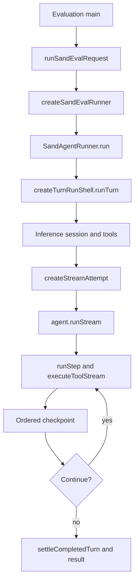

# Turns, runner, and the paths actually present

[English](README.en.md) · [Português (Brasil)](README.md)

## Three pieces of evidence that must remain separate

| Layer | What the snapshot establishes |
| --- | --- |
| Regular host | The gateway forwards Temporal agents to the server; `SendPipeline` refuses local BOX sends. |
| Evaluation runner | There is concrete construction of `SandAgentRunner`, a prompt session, and an execution loop. |
| Remote service | Contracts/clients are present; the production workflow implementation does not appear in these excerpts. |

Sources: [host-main.cjs:492012–492024](../../../reference/runtime/host-main.cjs#L492012-L492024), [host-main.cjs:740157–740194](../../../reference/runtime/host-main.cjs#L740157-L740194), [sand-eval-runner.cjs:596865–596867](../../../reference/runtime/sand-eval-runner.cjs#L596865-L596867), [sand-eval-runner.cjs:630752–630800](../../../reference/runtime/sand-eval-runner.cjs#L630752-L630800).

### What the names do not justify concluding

`turn-runtime.ts` in the host contains `connectCodeOf`, `turnTrayTitleKind`, and `classifyAgentError`. `turn-execution-service.ts` contains `TurnExecutionRegistry` with `localWorkAllowed` and a setter. In this bundle, they are not the body of a local engine operating behind `sendPrompt`. Sources: [host-main.cjs:736892–736952](../../../reference/runtime/host-main.cjs#L736892-L736952), [host-main.cjs:784581–784598](../../../reference/runtime/host-main.cjs#L784581-L784598).

## Concrete evaluation-runner flow



This diagram documents the recovered evaluation path. It does not claim that the regular host injects this runner. Sources: [sand-eval-runner.cjs:630263–630361](../../../reference/runtime/sand-eval-runner.cjs#L630263-L630361), [sand-eval-runner.cjs:594078–594086](../../../reference/runtime/sand-eval-runner.cjs#L594078-L594086), [sand-eval-runner.cjs:591502–592546](../../../reference/runtime/sand-eval-runner.cjs#L591502-L592546), [sand-eval-runner.cjs:446751–446880](../../../reference/runtime/sand-eval-runner.cjs#L446751-L446880).

## Behavior by function

### `createSandEvalRunner` and `buildSandEvalRunnerOptions`

The factory applies a profile to the composed options and instantiates `SandAgentRunner`. The composer injects ports for inference, box, transport, MCP, context, memory, and evaluation alternatives. This enables composition separate from the host process. Source: [sand-eval-runner.cjs:596773–596867](../../../reference/runtime/sand-eval-runner.cjs#L596773-L596867).

### `SandAgentRunner.run`

Before executing a main agent, resets combined computer-use state. It extracts `prompt`, `options`, and `scope`, binds spending context through `activeSpendRequest.bindRun`, and delegates to the run shell. The runner holds conversation state and ports; the public method alone is not the generation loop. Source: [sand-eval-runner.cjs:594078–594086](../../../reference/runtime/sand-eval-runner.cjs#L594078-L594086).

### `createTurnRunShell.run` and `runTurn`

`run` installs observation and metrics; `runTurn` determines origin, automation, authorship, approval epoch, and revival context. An empty prompt is refused when there is no media/attachment and the call is not a resume or compaction action. `inferenceRequestId` is received or generated. The summarization session is built separately from the main session. Sources: [sand-eval-runner.cjs:591415–591592](../../../reference/runtime/sand-eval-runner.cjs#L591415-L591592), [sand-eval-runner.cjs:592040–592125](../../../reference/runtime/sand-eval-runner.cjs#L592040-L592125). [README](../../functions/createTurnRunShell/README.en.md).

The run shell maintains cancellation callbacks and generations. During preparation, it resolves the box, discovers MCP, directs tool composition, and binds lineage metadata. `prewarm` has its own semantics: it limits execution and disables tool execution; it does not represent a complete response to the user. Sources: [sand-eval-runner.cjs:592040–592243](../../../reference/runtime/sand-eval-runner.cjs#L592040-L592243), [sand-eval-runner.cjs:592292–592330](../../../reference/runtime/sand-eval-runner.cjs#L592292-L592330).

### `discoverTurnStartMcpTools`

Resolves tools at the start, with a deadline. Without an MCP port, it returns an empty list; a discovery failure records unavailability for the turn and continues with the retrieved tools, unless cancelled. It also requests an account-config refresh. This does not justify saying that the account has no connectors. Source: [sand-eval-runner.cjs:591376–591414](../../../reference/runtime/sand-eval-runner.cjs#L591376-L591414); the corresponding message appears in [host-main.cjs:782289–782293](../../../reference/runtime/host-main.cjs#L782289-L782293).

### `createStreamAttempt` and `agent.runStream`

The run shell builds an attempt with a retry policy and persistence callback. On the first attempt, it uses `baseState`; on resume, it uses the checkpoint and `RESUME_TURN_ACTION`. If the checkpoint already marks the same turn as completed or awaiting the user and no calls remain pending, it returns that state without repeating the work. Source: [sand-eval-runner.cjs:592292–592329](../../../reference/runtime/sand-eval-runner.cjs#L592292-L592329).

### `Agent.runStep` and `rootPromptExecutor.executeToolStream`

The low-level loop prepares tools, state, callbacks, and context for a step, then calls the stream executor. The result includes model and tool activity. The implementation belongs to the compiled agent package composed by the harness; it is not an independent proactive algorithm. Source: [sand-eval-runner.cjs:446751–446885](../../../reference/runtime/sand-eval-runner.cjs#L446751-L446885). The host bundle also contains this shared layer in [host-main.cjs:654204–654330](../../../reference/runtime/host-main.cjs#L654204-L654330).

### Run-shell checkpoint persistence

Each checkpoint enters `checkpointChain`, a queue of Promises. Before writing, the function checks the run generation and current cancellation callback. In sequence, it prepares, persists, confirms step waiters, records computer use, confirms automations, and processes end requests only when no calls remain pending. A `finally` always releases the next link. Source: [sand-eval-runner.cjs:592329–592364](../../../reference/runtime/sand-eval-runner.cjs#L592329-L592364).

### `createTurnSettle` and termination

Normal completion uses `settleCompletedTurn` after draining tool-call effects. Abort, upgrade, step limit, and the tool-failure breaker receive separate handling. A completed step does not automatically mean a visible response: the transport receives specific events, and the harness sends to the user through a tool. Sources: [sand-eval-runner.cjs:590682–590776](../../../reference/runtime/sand-eval-runner.cjs#L590682-L590776), [sand-eval-runner.cjs:592389–592546](../../../reference/runtime/sand-eval-runner.cjs#L592389-L592546), [sand-eval-runner.cjs:594039–594054](../../../reference/runtime/sand-eval-runner.cjs#L594039-L594054).

## Evaluation result

`runSandEvalRequest` collects delivered messages, updates, tool calls, transcript segments, token usage, and inference IDs. The result may contain `turnCutOffAtDeadline`, `backgroundWaitCutOff`, and abandoned subagents. Consequently, `status: completed` in the result does not prove that every execution ended naturally. Source: [sand-eval-runner.cjs:630398–630568](../../../reference/runtime/sand-eval-runner.cjs#L630398-L630568).

## Verification

```bash
rg -n 'function createSandEvalRunner|var SandAgentRunner =|function createTurnRunShell|createStreamAttempt|executeToolStream' reference/runtime/sand-eval-runner.cjs
sed -n '740157,740194p' reference/runtime/host-main.cjs
```

Next reading: [inference](../inference/README.en.md), [cancellation](../cancellation-recovery/README.en.md), and [transcripts](../transcripts/README.en.md).
