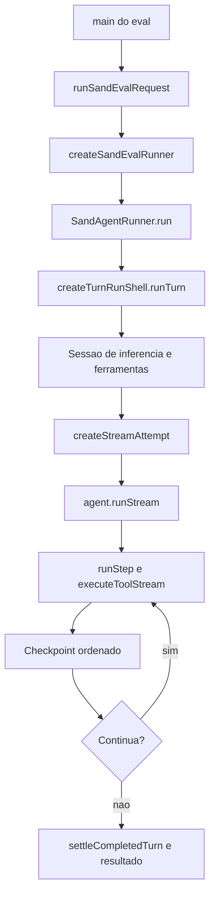

# Turnos, runner e caminhos realmente presentes

## Três evidências que precisam permanecer separadas

| Camada | O que o snapshot comprova |
| --- | --- |
| Host regular | O gateway encaminha agentes Temporal ao servidor; `SendPipeline` recusa os sends BOX locais. |
| Runner de avaliação | Há construção concreta de `SandAgentRunner`, prompt session e loop de execução. |
| Serviço remoto | Há contratos/clientes; a implementação do workflow de produção não aparece nesses trechos. |

Fontes: [host-main.cjs:492012–492024](../../../reference/runtime/host-main.cjs#L492012-L492024), [host-main.cjs:740157–740194](../../../reference/runtime/host-main.cjs#L740157-L740194), [sand-eval-runner.cjs:596865–596867](../../../reference/runtime/sand-eval-runner.cjs#L596865-L596867), [sand-eval-runner.cjs:630752–630800](../../../reference/runtime/sand-eval-runner.cjs#L630752-L630800).

### O que os nomes não autorizam concluir

`turn-runtime.ts` no host contém `connectCodeOf`, `turnTrayTitleKind` e `classifyAgentError`. `turn-execution-service.ts` contém `TurnExecutionRegistry` com `localWorkAllowed` e setter. Não são, neste bundle, o corpo de um motor local funcionando atrás de `sendPrompt`. Fontes: [host-main.cjs:736892–736952](../../../reference/runtime/host-main.cjs#L736892-L736952), [host-main.cjs:784581–784598](../../../reference/runtime/host-main.cjs#L784581-L784598).

## Fluxo concreto do runner de avaliação



O desenho documenta o caminho de avaliação recuperado. Não atribui ao host regular a injeção desse runner. Fontes: [sand-eval-runner.cjs:630263–630361](../../../reference/runtime/sand-eval-runner.cjs#L630263-L630361), [sand-eval-runner.cjs:594078–594086](../../../reference/runtime/sand-eval-runner.cjs#L594078-L594086), [sand-eval-runner.cjs:591502–592546](../../../reference/runtime/sand-eval-runner.cjs#L591502-L592546), [sand-eval-runner.cjs:446751–446880](../../../reference/runtime/sand-eval-runner.cjs#L446751-L446880).

## Funcionamento por função

### `createSandEvalRunner` e `buildSandEvalRunnerOptions`

A fábrica aplica um perfil às opções compostas e instancia `SandAgentRunner`. O compositor injeta portas de inferência, box, transporte, MCP, contexto, memória e alternativas de avaliação. Isso permite uma composição separada do processo de host. Fonte: [sand-eval-runner.cjs:596773–596867](../../../reference/runtime/sand-eval-runner.cjs#L596773-L596867).

### `SandAgentRunner.run`

Antes de executar um agente principal, reseta o estado de computer use combinado. Extrai `prompt`, `options` e `scope`, associa o contexto de gasto via `activeSpendRequest.bindRun` e delega à run shell. O runner guarda estado de conversa e portas; o método público não é sozinho o loop de geração. Fonte: [sand-eval-runner.cjs:594078–594086](../../../reference/runtime/sand-eval-runner.cjs#L594078-L594086).

### `createTurnRunShell.run` e `runTurn`

`run` instala observação e métricas; `runTurn` determina origem, automação, autoria, época de aprovação e contexto de revival. Prompt vazio é recusado quando não há mídia/anexos e a chamada não é uma ação de resume ou compactação. `inferenceRequestId` é recebido ou gerado. A sessão de sumarização é construída separadamente da sessão principal. Fontes: [sand-eval-runner.cjs:591415–591592](../../../reference/runtime/sand-eval-runner.cjs#L591415-L591592), [sand-eval-runner.cjs:592040–592125](../../../reference/runtime/sand-eval-runner.cjs#L592040-L592125). [README](../../functions/createTurnRunShell/README.md).

A run shell mantém callbacks de cancelamento e gerações. Na preparação, resolve box, descobre MCP, instrui composição de ferramentas e vincula metadados de linhagem. `prewarm` tem semântica própria: limita a execução e desliga execução de ferramentas; não representa uma resposta completa ao usuário. Fontes: [sand-eval-runner.cjs:592040–592243](../../../reference/runtime/sand-eval-runner.cjs#L592040-L592243), [sand-eval-runner.cjs:592292–592330](../../../reference/runtime/sand-eval-runner.cjs#L592292-L592330).

### `discoverTurnStartMcpTools`

Resolve ferramentas no início, com deadline. Sem porta MCP, retorna lista vazia; falha de discovery registra indisponibilidade para o turno e prossegue com ferramentas recuperadas, salvo cancelamento. Também pede refresh de account config. Isso não autoriza dizer que a conta não possui conectores. Fonte: [sand-eval-runner.cjs:591376–591414](../../../reference/runtime/sand-eval-runner.cjs#L591376-L591414); a mensagem correspondente existe em [host-main.cjs:782289–782293](../../../reference/runtime/host-main.cjs#L782289-L782293).

### `createStreamAttempt` e `agent.runStream`

A run shell constrói uma tentativa com política de retry e callback de persistência. Na primeira tentativa usa `baseState`; em uma retomada usa o checkpoint e `RESUME_TURN_ACTION`. Se o checkpoint já marca o mesmo turno como concluído ou aguardando usuário e não há chamadas pendentes, retorna esse estado sem repetir trabalho. Fonte: [sand-eval-runner.cjs:592292–592329](../../../reference/runtime/sand-eval-runner.cjs#L592292-L592329).

### `Agent.runStep` e `rootPromptExecutor.executeToolStream`

O loop de baixo nível prepara ferramentas, estado, callbacks e contexto para uma etapa e chama o executor de stream. O resultado inclui atividade do modelo e ferramentas. A implementação é do pacote agent compilado, que o harness compõe, não um algoritmo proativo independente. Fonte: [sand-eval-runner.cjs:446751–446885](../../../reference/runtime/sand-eval-runner.cjs#L446751-L446885). O bundle do host também contém essa camada compartilhada, em [host-main.cjs:654204–654330](../../../reference/runtime/host-main.cjs#L654204-L654330).

### Persistência de checkpoint da run shell

Cada checkpoint entra em `checkpointChain`, uma fila de Promises. Antes da gravação, a função verifica a geração da run e o callback de cancelamento vigente. Em sequência prepara, persiste, confirma waiters de etapa, registra computer use, confirma automações e processa pedidos de término apenas quando não há chamadas pendentes. Um `finally` sempre libera o próximo elo. Fonte: [sand-eval-runner.cjs:592329–592364](../../../reference/runtime/sand-eval-runner.cjs#L592329-L592364).

### `createTurnSettle` e término

A conclusão normal usa `settleCompletedTurn` depois de drenar efeitos de tool calls. Há tratamentos separados para abort, upgrade, limite de passos e breaker de falhas de ferramenta. Uma etapa terminada não equivale automaticamente a uma resposta visível: o transporte recebe eventos específicos, e o harness usa envio ao usuário por ferramenta. Fontes: [sand-eval-runner.cjs:590682–590776](../../../reference/runtime/sand-eval-runner.cjs#L590682-L590776), [sand-eval-runner.cjs:592389–592546](../../../reference/runtime/sand-eval-runner.cjs#L592389-L592546), [sand-eval-runner.cjs:594039–594054](../../../reference/runtime/sand-eval-runner.cjs#L594039-L594054).

## Resultado de avaliação

`runSandEvalRequest` coleta mensagens entregues, atualizações, tool calls, segmentos de transcript, uso de tokens e IDs de inferência. O resultado pode conter `turnCutOffAtDeadline`, `backgroundWaitCutOff` e subagentes abandonados. Por isso `status: completed` no resultado não é prova de que toda execução terminou naturalmente. Fonte: [sand-eval-runner.cjs:630398–630568](../../../reference/runtime/sand-eval-runner.cjs#L630398-L630568).

## Conferência

```bash
rg -n 'function createSandEvalRunner|var SandAgentRunner =|function createTurnRunShell|createStreamAttempt|executeToolStream' reference/runtime/sand-eval-runner.cjs
sed -n '740157,740194p' reference/runtime/host-main.cjs
```

Próximas leituras: [inferência](../inference/README.md), [cancelamento](../cancellation-recovery/README.md), [transcripts](../transcripts/README.md).
