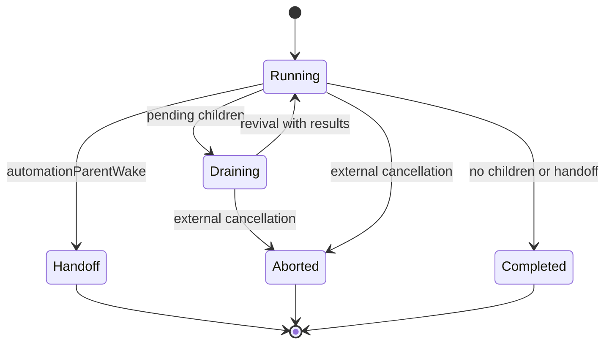

# `createAutomationSubagentDispatch`

[English](README.en.md) · [Português (Brasil)](README.md)

## Role

Returns the dispatcher for an automation that has already been selected. Encapsulates silent execution, children, in-flight deduplication, and handoff. It is not the scanner for spontaneous opportunities. [Complete implementation](../../../reference/runtime/sand-eval-runner.cjs#L584012-L584122).

## Interface

The factory accepts `host` and `createSubagentRunner`. The returned function consumes `subagentAgentId`, `prompt`, `automationId`, `automationName`, `connectorScope`, and metadata such as `runUuid`, `turnUnitId`, and `onRequestId`. Returns a Promise of a run result.

Its private state is `automationSubagentRuns: Map<subagentAgentId, Promise>`. This is deduplication during execution. The map is neither a persisted ledger nor a list of schedules.

## Internal steps

| Step | How it works |
| --- | --- |
| Deduplicate | Returns the existing Promise for the same ID |
| Create executor | `SubagentArgs` with executor type, `toolCallId: ""`, and `readonly: false` |
| Set origin | `requestSource: "automation"`, ID, and `originatingFlow: "automation"` |
| Isolate communication | Transport created with `parentMediated: true` |
| Prepare collection | Handlers convert shell and subagent completions into a local list |
| Start | `hidden`, `isSilenceAllowed`, and `quietWork` all set to true |
| Resume children | Drains background work; builds revival with the results; starts a new run |
| Finish | Clears handlers and cancels children on handoff, or drains external cancellation |
| Publish lifecycle | `dispatchBackgroundSubagent` records quiet origin and correlation IDs |
| Clean up | Removes the Promise from the map on both success and error |

Sources: [preparation](../../../reference/runtime/sand-eval-runner.cjs#L584012-L584062), [execution and shutdown](../../../reference/runtime/sand-eval-runner.cjs#L584063-L584096), [registration and cleanup](../../../reference/runtime/sand-eval-runner.cjs#L584097-L584122).

## State and stop conditions

The loop continues only while the host has not signaled an abort, the result does not contain `automationParentWake`, and there is child work or a completion to consume. `drainBackgroundWork` waits for activity to finish; if no completions appear, it checks again. When reactivating the executor, it forces `automationWake.untrusted: true`, while preserving the ID and name. This avoids treating a tool/child result as a new trusted user instruction.

`asAborted` removes `automationParentWake` and sets `aborted: true`. External cancellation takes precedence in the final result, including after settlement if the subagent record indicates an abort. Canceled work is not automatically redispatched.

## Relevant limitations

This common dispatch uses `readonly: false`. There are tool policies specific to automations and separate policies for read-only runs. This function does not set `platformProactivity`; attributing opportunity selection to it would go beyond the code. The runner is compiled into the evaluation bundle and does not prove that the host's retired BOX entry point invokes it in production.

[Automations](../../components/automations/README.en.md) · [Proactivity](../../components/proactivity/README.en.md) · [WakeParent](../createWakeParentTool/README.en.md).
