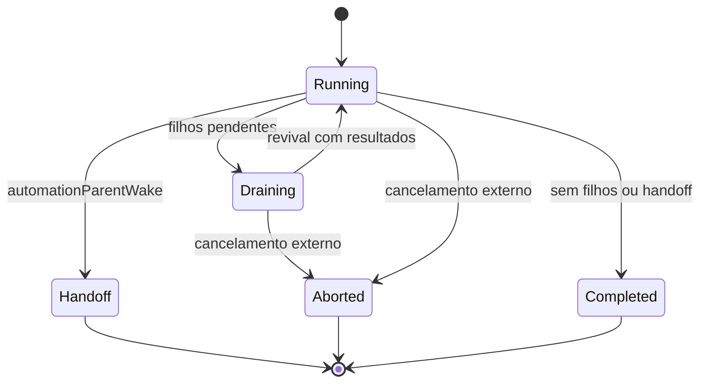

# `createAutomationSubagentDispatch`

## Papel

Retorna o dispatcher de uma automação que já foi selecionada. Encapsula execução silenciosa, filhos, deduplicação em andamento e handoff. Não é o scanner de oportunidades espontâneas. [Implementação completa](../../../reference/runtime/sand-eval-runner.cjs#L584012-L584122).

## Interface

A factory recebe `host` e `createSubagentRunner`. A função retornada consome `subagentAgentId`, `prompt`, `automationId`, `automationName`, `connectorScope` e metadados como `runUuid`, `turnUnitId` e `onRequestId`. Devolve uma promise de resultado de run.

O estado privado é `automationSubagentRuns: Map<subagentAgentId, Promise>`. Essa é deduplicação durante a execução. O mapa não é um ledger persistido nem uma lista de agendamentos.

## Passos internos

| Etapa | Como é feita |
| --- | --- |
| Deduplicar | Retorna a promise existente para o mesmo ID |
| Criar executor | `SubagentArgs` com tipo executor, `toolCallId: ""` e `readonly: false` |
| Fixar origem | `requestSource: "automation"`, ID e `originatingFlow: "automation"` |
| Isolar comunicação | Transporte criado com `parentMediated: true` |
| Preparar coleta | Handlers convertem completions de shell e subagentes em uma lista local |
| Iniciar | `hidden`, `isSilenceAllowed` e `quietWork` iguais a true |
| Retomar filhos | Drena background work; monta revival com os resultados; inicia nova run |
| Encerrar | Limpa handlers e cancela filhos ao fazer handoff, ou drena cancelamento externo |
| Publicar lifecycle | `dispatchBackgroundSubagent` registra origem quiet e IDs de correlação |
| Limpar | Remove a promise do mapa tanto em sucesso como em erro |

Fontes: [preparo](../../../reference/runtime/sand-eval-runner.cjs#L584012-L584062), [execução e encerramento](../../../reference/runtime/sand-eval-runner.cjs#L584063-L584096), [registro e cleanup](../../../reference/runtime/sand-eval-runner.cjs#L584097-L584122).

## Estado e condições de parada

O loop prossegue apenas enquanto o host não sinaliza aborto, o resultado não contém `automationParentWake` e existe trabalho filho ou completion a consumir. `drainBackgroundWork` espera a atividade terminar; se não surgem completions, volta a verificar. Ao reativar o executor, força `automationWake.untrusted: true`, embora preserve ID e nome. Isso evita tratar um resultado de ferramenta/filho como uma nova instrução confiável do usuário.

`asAborted` retira `automationParentWake` e estabelece `aborted: true`. O cancelamento externo tem precedência no resultado final, inclusive após o settlement se o registro do subagente indicar aborto. Não há redispatch automático de trabalho cancelado.

## Limitações relevantes

Este dispatch comum usa `readonly: false`. Há políticas de ferramentas específicas para automações e políticas distintas para runs somente leitura. O campo `platformProactivity` não é definido por essa função; atribuir a ela a escolha de oportunidades seria extrapolar o código. O runner está compilado no bundle de avaliação e não comprova que a entrada BOX aposentada do host o aciona em produção.

[Automações](../../components/automations/README.md) · [Proatividade](../../components/proactivity/README.md) · [WakeParent](../createWakeParentTool/README.md).
