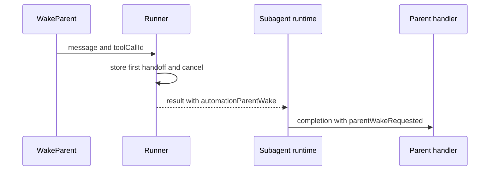

# `createWakeParentTool`

[English](README.en.md) · [Português (Brasil)](README.md)

## Purpose

Builds the tool that ends an automation run and hands the parent the complete context of an action it needs to take over. The factory and runtime callback must be read together: the former exposes the tool; the latter implements termination. [Factory](../../../reference/runtime/sand-eval-runner.cjs#L564143-L564161), [callback](../../../reference/runtime/sand-eval-runner.cjs#L591766-L591775).

## Inputs, output, and dependencies

| Element | Contract |
| --- | --- |
| `deps.requestAutomationParentWake` | Callback injected by the runner |
| `message` | String, trim, minimum of one character |
| `toolCallId` | Call identifier forwarded by the tool context |
| Tool return value | Handoff confirmation text |
| Subsequent run return value | `automationParentWake` with the requested text |

`defineCommunicateTool` registers identifier `WAKE_PARENT`, name `WakeParent`, and the schema. Execute calls the callback with `{ message, wakeParentToolCallId }`. It does not send an email, write to the main chat, or select the parent through a primary-bot lookup.

## Algorithm that gives the call its effect

1. The builder offers this variant when the run has `requestAutomationParentWake`.
2. The callback is created only for `host.isParentMediatedAutomationSubagent`.
3. If there is already a handoff, it ignores the next call; the first text wins.
4. Stores the message and calls `cancelRun(automationParentWakeAbort(toolCallId))`.
5. The abort error is intentional and identifies the call that must be considered completed.
6. Run finalization preserves this result as a handoff rather than classifying it as a simple abort.
7. The subagent runtime replaces `finalAssistantText` with the handoff and sets `parentWakeRequested`.

[Builder](../../../reference/runtime/sand-eval-runner.cjs#L564647-L564657), [abort](../../../reference/runtime/sand-eval-runner.cjs#L554063-L554085), [result](../../../reference/runtime/sand-eval-runner.cjs#L592532-L592545), [completion](../../../reference/runtime/sand-eval-runner.cjs#L535295-L535329).

The last participant must be connected. The runtime logs that it will not notify the parent when the handler does not exist. The tool's textual confirmation is therefore not proof of delivery to the user. [Missing handler](../../../reference/runtime/sand-eval-runner.cjs#L535455-L535471).

## Cases and limits

| Case | Result supported by the code |
| --- | --- |
| Empty message after trim | Schema rejects it |
| Two calls in the same runner | The first stored handoff wins |
| External cancellation takes precedence in dispatch | Dispatch removes the handoff and returns an aborted result |
| Normal final assistant output without the tool | Does not become `parentWakeRequested` |
| Parent receives a delayed result | Revival policy considers its age |

The caller of this tool cannot add context after the interruption; this is why the description requires the complete payload. For a result that can wait, the prompt recommends finishing normally and remaining silent. [Description in the host](../../../reference/runtime/host-main.cjs#L768628-L768646), [dispatch and external abort](../../../reference/runtime/sand-eval-runner.cjs#L584063-L584096).

## Relationships

[Proactivity](../../components/proactivity/README.en.md) · [Automation dispatch](../createAutomationSubagentDispatch/README.en.md) · [Revival classification](../revivalInstructionOf/README.en.md).

Static reading of snapshot `655acca99bff0d17466547611108f94ed6a8a5e7`; the parent's remote behavior was not executed.
