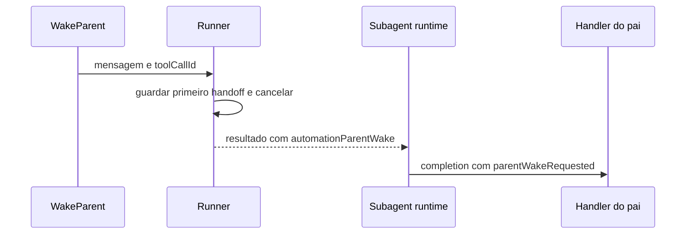

# `createWakeParentTool`

## Para que serve

Constrói a ferramenta que encerra uma run de automação e entrega ao pai o contexto completo de uma ação que ele precisa assumir. A factory e o callback de runtime precisam ser lidos juntos: o primeiro expõe a ferramenta; o segundo implementa o encerramento. [Factory](../../../reference/runtime/sand-eval-runner.cjs#L564143-L564161), [callback](../../../reference/runtime/sand-eval-runner.cjs#L591766-L591775).

## Entradas, saída e dependências

| Elemento | Contrato |
| --- | --- |
| `deps.requestAutomationParentWake` | Callback injetado pelo runner |
| `message` | String, trim, mínimo de um caractere |
| `toolCallId` | Identificador da chamada, encaminhado pelo contexto da ferramenta |
| Retorno do tool | Texto de confirmação de handoff |
| Retorno posterior da run | `automationParentWake` com o texto solicitado |

`defineCommunicateTool` registra identificador `WAKE_PARENT`, nome `WakeParent` e schema. O execute chama o callback com `{ message, wakeParentToolCallId }`. Não faz um envio de email, não grava no chat principal e não escolhe o pai por uma consulta ao primary bot.

## Algoritmo que dá efeito à chamada

1. O builder oferece essa variante quando a run possui `requestAutomationParentWake`.
2. O callback só é criado para `host.isParentMediatedAutomationSubagent`.
3. Se já há handoff, ignora a chamada seguinte; o primeiro texto vence.
4. Guarda a mensagem e chama `cancelRun(automationParentWakeAbort(toolCallId))`.
5. O erro de aborto é intencional e identifica a chamada que deve ser considerada concluída.
6. O fechamento da run preserva esse resultado como handoff, sem classificá-lo como mero aborto.
7. O runtime do subagente troca `finalAssistantText` pelo handoff e marca `parentWakeRequested`.

[Builder](../../../reference/runtime/sand-eval-runner.cjs#L564647-L564657), [aborto](../../../reference/runtime/sand-eval-runner.cjs#L554063-L554085), [resultado](../../../reference/runtime/sand-eval-runner.cjs#L592532-L592545), [completion](../../../reference/runtime/sand-eval-runner.cjs#L535295-L535329).

O último participante precisa estar conectado. O runtime registra que não notificará o pai quando o handler não existe. Portanto a confirmação textual da ferramenta não é um comprovante de entrega ao usuário. [Ausência do handler](../../../reference/runtime/sand-eval-runner.cjs#L535455-L535471).

## Casos e limites

| Caso | Resultado sustentado pelo código |
| --- | --- |
| Mensagem vazia após trim | Schema rejeita |
| Duas chamadas no mesmo runner | Primeiro handoff guardado vence |
| Cancelamento externo domina o dispatch | O dispatch remove o handoff e retorna abortado |
| Final assistant normal, sem tool | Não se transforma em `parentWakeRequested` |
| Pai recebe resultado atrasado | A política de revival avalia sua idade |

O caller desta ferramenta não pode acrescentar contexto depois da interrupção; por isso a descrição exige o payload completo. Para o resultado aguardável, o prompt recomenda terminar normalmente e conservar silêncio. [Descrição no host](../../../reference/runtime/host-main.cjs#L768628-L768646), [dispatch e aborto externo](../../../reference/runtime/sand-eval-runner.cjs#L584063-L584096).

## Relações

[Proatividade](../../components/proactivity/README.md) · [Dispatch de automação](../createAutomationSubagentDispatch/README.md) · [Classificação de revival](../revivalInstructionOf/README.md).

Leitura estática do snapshot `655acca99bff0d17466547611108f94ed6a8a5e7`; o comportamento remoto do pai não foi executado.
